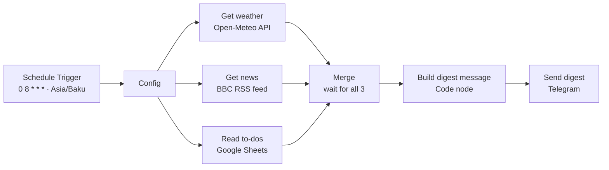
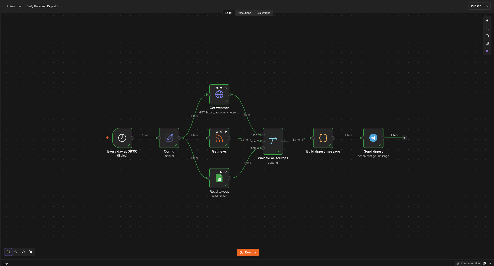
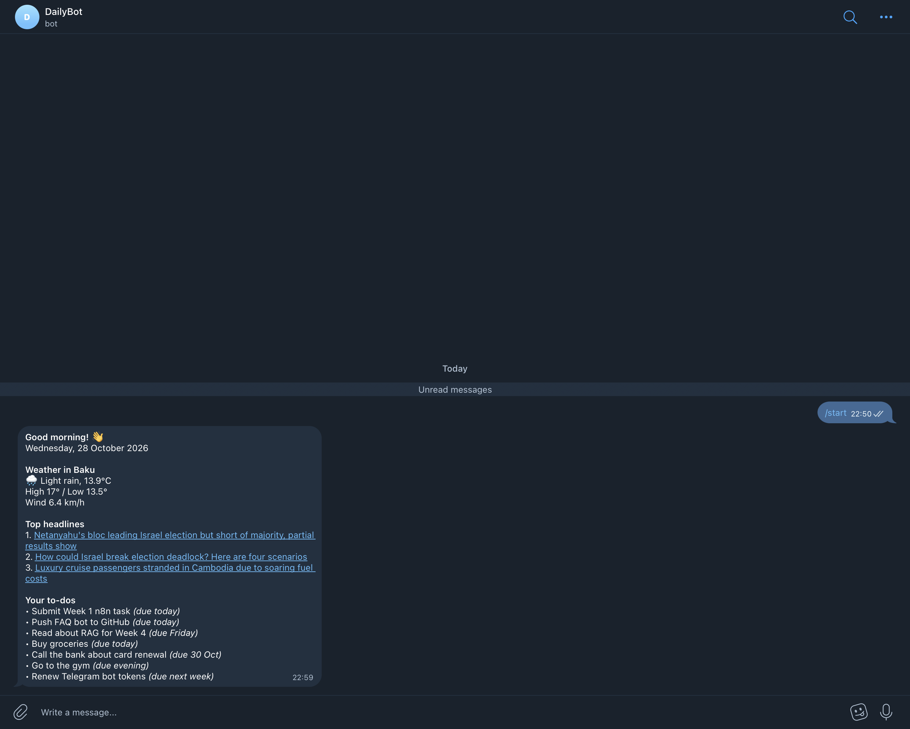

# Daily Personal Digest Bot (n8n + Telegram)

A **scheduled** n8n workflow that every morning at **08:00 Baku time** collects the weather, the top news headlines and your open to-dos from a Google Sheet, merges them, and sends them as **one formatted Telegram message**.

Unlike a reactive chatbot, nothing has to message the bot first: the workflow starts itself on a schedule.

---

## Example message

```
Good morning! 👋
Wednesday, 28 October 2026

Weather in Baku
⛅ Partly cloudy, 19.3°C
High 22° / Low 14°
Wind 12.1 km/h

Top headlines
1. <headline 1>   (link)
2. <headline 2>   (link)
3. <headline 3>   (link)

Your to-dos
• Submit Week 1 n8n task (due today)
• Push FAQ bot to GitHub (due today)
• Read about RAG for Week 4 (due Friday)
…
```

---

## Project structure

```
.
├── workflow/
│   └── daily-digest-bot.json    # n8n workflow (import this)
├── data/
│   └── todo_mock_data.csv       # example to-do rows for the Google Sheet
├── screenshots/
│   ├── canvas.png               # full workflow canvas
│   ├── telegram-digest.png      # the received digest message
└── README.md
```

---

## Architecture



| Node | Purpose |
|---|---|
| **Every day at 08:00 (Baku)** | Schedule Trigger with cron `0 8 * * *` |
| **Config** | One place for settings: chat ID, city, coordinates, RSS feed URL |
| **Get weather** | Current weather plus today's high/low from Open-Meteo (free, no API key) |
| **Get news** | Reads the BBC World RSS feed |
| **Read to-dos** | Reads the to-do rows from Google Sheets |
| **Wait for all sources** | Merge node with 3 inputs: continues only when all three branches have finished |
| **Build digest message** | JavaScript Code node that builds one Markdown message |
| **Send digest** | Sends the message through the Telegram bot |

---

## Key design decisions

### Scheduling and timezone
- The cron expression `0 8 * * *` means *minute 0, hour 8, every day*.
- **What "08:00" means depends on the timezone.** The workflow's own setting is explicitly **Asia/Baku** (*Workflow Settings → Timezone*), so it does not depend on the server's or instance's default (often UTC, which would deliver the digest at 12:00 Baku time).
- The date shown in the message is formatted separately with `$now.setZone('Asia/Baku')`. That only affects the displayed text; the **workflow timezone** is what decides when the trigger fires.

### Merging three sources (fan-out → fan-in)
- Config fans out to three branches that run independently.
- The **Merge node** (3 inputs) waits until all three have finished, so exactly one message is built.
- The Code node reads each source **by node name** (`$('Get weather')`, `$('Get news')`, `$('Read to-dos')`), so the order in which the branches finish does not matter.

### Partial failure
Each source has *On Error: Continue* and *Always Output Data*. If one source is down, the digest is still sent, with a short note for that section (for example *"No headlines available right now."*) instead of no message at all.

### Message formatting
- Telegram **Markdown** for bold section titles and clickable headline links; link previews are disabled to keep the message compact.
- Text from outside sources (headlines, to-dos) can contain `_`, `*`, `` ` `` or `[`, which Telegram would read as formatting and reject the whole message. These characters are escaped in normal text and removed from link text.
- Weather codes from Open-Meteo are translated into an icon and a label (e.g. `2` → ⛅ Partly cloudy).

### To-do sheet
Columns: `task | due | done`. Rows where `done` is `yes`, `true`, `done` or `1` are skipped, so finished tasks drop out of the digest without being deleted. The `due` value is shown when present.

---

## Setup

1. **Telegram bot:** create one with [@BotFather](https://t.me/BotFather), open it and press **Start** (a bot cannot message a user who has never started it).
2. **Chat ID:** in a private chat, your chat ID is your Telegram user ID. You can find it by sending the bot a message and opening `https://api.telegram.org/bot<TOKEN>/getUpdates`.
3. **Google Sheet:** create a sheet with the header row `task | due | done` and import [`data/todo_mock_data.csv`](data/todo_mock_data.csv).
4. **n8n:** import `workflow/daily-digest-bot.json`, then:
   - create the **Telegram** and **Google Sheets** credentials and select them in *Send digest* and *Read to-dos*;
   - select your sheet in *Read to-dos*;
   - set your chat ID (and optionally another city or feed) in **Config**;
   - check *Workflow Settings → Timezone* = **Asia/Baku**.
5. Click **Execute workflow** to test, then **Publish** to enable the schedule.

---

## Testing

### Manual run
**Execute workflow** in the editor runs the whole flow immediately, so the message content can be checked before enabling the schedule.

### Timezone test
To prove the schedule runs on Baku time and not UTC:

1. Set the cron to a few minutes ahead in **Baku time** (for example `47 17 * * *` for 17:47).
2. Publish the workflow and wait.
3. In **Executions**, the run starts at **17:47 Baku time**. (On UTC it would have started at 21:47 Baku time.)
4. Set the cron back to `0 8 * * *` and publish again.

### Results
| Test | Expected | Result |
|---|---|---|
| Manual run | One message with all three sections | ✅ |
| To-dos marked `done` | Not shown in the digest | ✅ |
| Scheduled run at a set Baku time | Starts at that Baku time | ✅ |

---

## Screenshots

### Workflow


### Received digest
